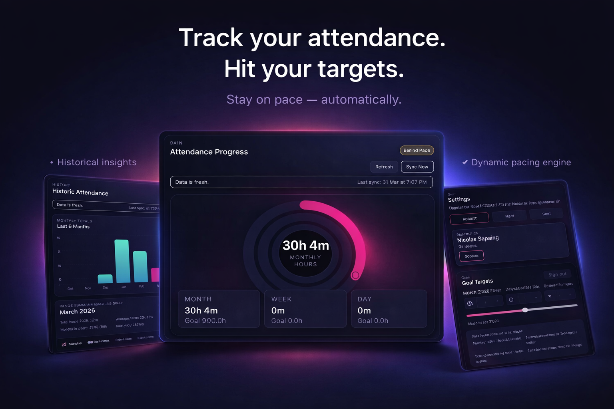

# TimeTracker42

TimeTracker42 is a mobile-first attendance tracker for 42 students. It signs users in with 42 OAuth, syncs official campus location sessions, and turns that attendance history into dashboard progress, monthly history, goals, deadlines, stale-data warnings, and manual sync feedback.

[](https://github.com/Equinox201/TimeTracker42/actions/workflows/ci.yml)

- **Live app:** https://timetracker42.pages.dev/
- **Try it without a 42 account:** https://timetracker42.pages.dev/demo (sample data for a fictional student, John Doe)

## Preview



## What It Does

- Secure 42 OAuth login through Supabase Edge Functions.
- Manual attendance sync from the 42 API.
- Daily, weekly, and monthly attendance progress.
- Six-month attendance history and monthly calendar views.
- User-owned goals and deadlines stored in Supabase Postgres.
- Stale/failed/last-sync status from `sync_runs`.
- Mobile-first web UI suitable for iPhone Safari and PWA-style use.

## Demo Mode

Recruiters and reviewers can explore the full app without a 42 account at `/demo`, or with the
**Try the demo** button on the login page.

- Everything is synthetic: attendance, goals, deadlines and sync history for a fictional student.
- No requests go to Supabase or 42 while demo mode is on.
- Data is generated relative to the current Singapore date, so the dashboard always shows a current month.
- The demo plugs in at the data-access layer (`web/src/demo/`), so the real summary, pace and goal
  calculations run over the generated rows. Edits (goals, deadlines, manual sync) live in memory and
  reset on reload.

## Current Architecture

```text
[Cloudflare Pages: React/Vite Web App]
          |
          | Supabase Auth session + RLS-protected table reads/writes
          v
[Supabase Auth] ---- [Supabase Postgres + RLS]
          ^
          |
[Supabase Edge Functions]
  - forty-two-oauth-start
  - forty-two-oauth-callback
  - auth-exchange
  - forty-two-sync-manual
          |
          v
       [42 API]
```

### Frontend

- Hosted on Cloudflare Pages.
- Built with React, TypeScript, Vite, Tailwind CSS, React Query, and Recharts.
- Reads dashboard, history, settings, goals, and deadlines directly from Supabase under RLS.
- Calls Edge Functions for 42 OAuth and manual sync.

### Auth

- Supabase Auth owns the browser session.
- 42 OAuth is implemented with custom Supabase Edge Functions:
  - `forty-two-oauth-start` creates a hashed OAuth state and redirects to 42.
  - `forty-two-oauth-callback` validates state, exchanges the 42 code server-side, stores 42 tokens, and creates a one-time exchange code.
  - `auth-exchange` redeems the exchange code and returns a Supabase `token_hash` for the browser to verify with Supabase Auth.
- Temporary email OTP fallback exists for development and is hidden by default.

### Data

- Supabase Postgres stores user-owned data:
  - `profiles`
  - `goals`
  - `deadlines`
  - `attendance_daily`
  - `location_sessions`
  - `sync_runs`
- RLS protects user-owned tables.
- `forty_two_tokens`, `oauth_states`, and `auth_exchange_codes` are internal service-role tables and are not directly readable by frontend clients.

### Manual Sync

- `forty-two-sync-manual` requires a Supabase JWT.
- It reads the authenticated user's stored 42 token server-side.
- It refreshes the 42 token when needed.
- It fetches 42 location sessions from:

```text
GET https://api.intra.42.fr/v2/users/:id/locations
```

- Manual sync currently fetches a bounded recent-history window: from the first day of the month five months before the current month through now, plus active sessions.
- Presence is elapsed time: overlapping or touching sessions are merged before totals are split at Singapore midnight, and sessions that began just before the window are included so its first day is accurate.
- Days stored locally that 42 no longer reports (after a complete fetch) are reconciled to zero; an entirely empty result never wipes history.
- One sync runs per user at a time (a unique index on running runs), with a short cooldown after a success; runs abandoned by a crash are recovered automatically.
- Calls to 42 have a timeout and bounded retries on 429/502/503/504, honouring `Retry-After`.
- Results are written by a single database function (`finalize_sync`), so sessions, daily totals and the run status land in one transaction.
- Today's row is marked `locations_live` while a session is open, and the dashboard shows it as provisional with the time of the last sync.

## Repository Structure

```text
web/                 React + TypeScript frontend for Cloudflare Pages
web/src/demo/        Synthetic data and in-memory store behind demo mode
supabase/migrations  Database schema, RLS policies
supabase/functions   Edge Functions (+ _shared/log.ts structured logger)
docs/                Architecture, runbook (incl. incident notes), function contract
.github/workflows    CI: web typecheck/test/build, Deno check of Edge Functions
```

## Frontend Environment Variables

Set these in Cloudflare Pages and local `.env` files:

```env
VITE_SUPABASE_URL=
VITE_SUPABASE_PUBLISHABLE_KEY=
VITE_SUPABASE_FUNCTIONS_URL=
VITE_ENABLE_EMAIL_OTP_FALLBACK=false
```

`VITE_ENABLE_EMAIL_OTP_FALLBACK` must be exactly `true` to show the development email OTP fallback. Production should leave it `false` or unset.

## Supabase Edge Function Secrets

Set these with Supabase secrets. Do not put these in frontend env vars.

```text
EDGE_SUPABASE_URL
EDGE_SUPABASE_SERVICE_ROLE_KEY
FORTY_TWO_CLIENT_ID
FORTY_TWO_CLIENT_SECRET
FORTY_TWO_REDIRECT_URI
FORTY_TWO_AUTH_EMAIL_DOMAIN
APP_ORIGIN
```

## Local Web Development

```bash
cd web
cp .env.example .env
npm install
npm run dev
```

Default local URL:

```text
http://127.0.0.1:5173
```

## Deployment

### Frontend: Cloudflare Pages

Deploy the `web/` app through Cloudflare Pages.

Recommended settings:

```text
Root directory: web
Build command: npm run build
Build output directory: dist
```

Configure the frontend environment variables listed above in Cloudflare Pages.

### Supabase Database

Apply migrations with:

```bash
npx supabase db push
```

### Supabase Edge Functions

Deploy functions with:

```bash
npx supabase functions deploy forty-two-oauth-start
npx supabase functions deploy forty-two-oauth-callback
npx supabase functions deploy auth-exchange
npx supabase functions deploy forty-two-sync-manual
```

Set or update secrets with:

```bash
npx supabase secrets set EDGE_SUPABASE_URL=... EDGE_SUPABASE_SERVICE_ROLE_KEY=...
npx supabase secrets set FORTY_TWO_CLIENT_ID=... FORTY_TWO_CLIENT_SECRET=...
npx supabase secrets set FORTY_TWO_REDIRECT_URI=... FORTY_TWO_AUTH_EMAIL_DOMAIN=... APP_ORIGIN=...
```

Do not commit actual secret values.

## Design Decisions

- **Custom 42 OAuth on Edge Functions.** The browser never sees 42 tokens or the client secret. The
  callback exchanges the code server-side, maps the stable 42 user id to a Supabase user, and hands the
  browser a one-time exchange code instead of a session.
- **Browser-bound login.** Before leaving for 42 the browser keeps a random verifier and sends only
  its SHA-256. The binding rides with the OAuth state and the exchange code, and redeeming the code
  requires the original verifier, so a callback URL replayed in another browser cannot sign it in
  (login CSRF). Redemption is one conditional `UPDATE`, so a wrong verifier does not burn the code.
- **Least-privilege database access.** API roles can only read their own rows (and write goals and
  deadlines). The 42 identity mapping, tokens, sync data and auth tables are writable only by Edge
  Functions; this is enforced by grants and covered by pgTAP tests (`supabase/tests/database`).
- **Single-use, hashed secrets.** OAuth `state` and exchange codes are stored as SHA-256 hashes and
  consumed once, which rejects CSRF and replay. The frontend shares one in-flight sign-in per callback
  URL, because React effects can re-run and a consumed code is (correctly) rejected.
- **RLS instead of an API server.** The web app reads and writes its own rows straight from Supabase
  under row-level security; Edge Functions exist only where a secret or the 42 API is involved.
- **Singapore operational days.** `attendance_daily.day` is keyed by `Asia/Singapore`, and the sync
  function and UI share that rule (`web/src/lib/singaporeDate.ts`), so day, week and month totals agree.
- **Safe failures.** Sync errors store short messages only; detailed reasons go to structured logs
  without tokens, codes or secrets.

## Observability

Every Edge Function logs one JSON line per event (`fn`, `event`, `request_id`). The runbook maps each
browser-visible `error=` code to the log event that explains it and documents secret rotation:
[docs/runbook.md](docs/runbook.md#diagnosing-sign-in-failures).

## Quality Gates

Run by CI on every pull request:

```bash
cd web
npm run typecheck
npm test
npm run build

# Database: migrations plus row-level-security and grant tests (needs Docker)
supabase start && supabase test db

# Edge Function shared modules
deno test supabase/functions/_shared/
```

Edge Functions are type-checked with Deno, one function at a time:

```bash
deno check --config supabase/functions/forty-two-oauth-callback/deno.json \
  supabase/functions/forty-two-oauth-callback/index.ts
```

The unit tests cover the pure logic: goal and pace math, Singapore date keys, formatters, the
single-use sign-in guard, and the demo data generators.

## Security

- 42 access and refresh tokens stay server-side in Supabase.
- The Supabase service role key is used only inside Edge Functions.
- Frontend clients use Supabase Auth sessions and RLS-protected access.
- User-owned tables are protected by RLS policies.
- OAuth state values are stored only as SHA-256 hashes.
- Auth exchange codes are stored only as SHA-256 hashes and are single-use.
- 42 client secret is never exposed to the frontend.
- Sync errors store safe short messages only, not raw payloads, tokens, or stack traces.

## Roadmap

- Scheduled sync through Supabase Edge Functions.
- Token encryption or Vault-backed token storage.
- Richer live-session display on dashboard/history.
- Remove the email OTP fallback once production 42 login has enough burn-in.
- Optional reconciliation/backfill using additional 42 API sources if needed.
