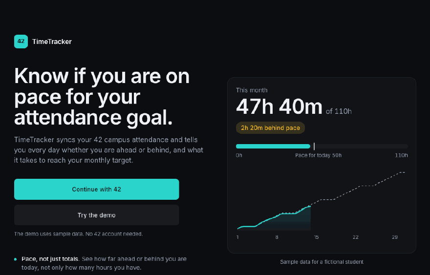
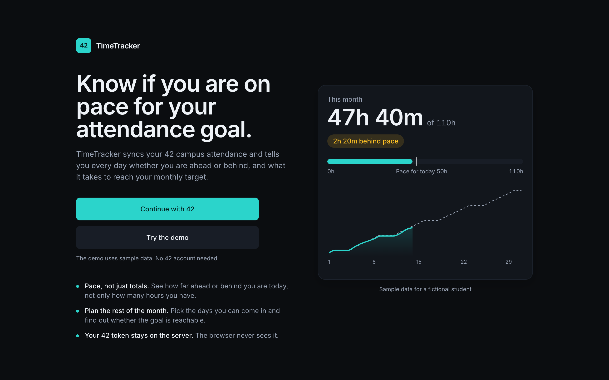
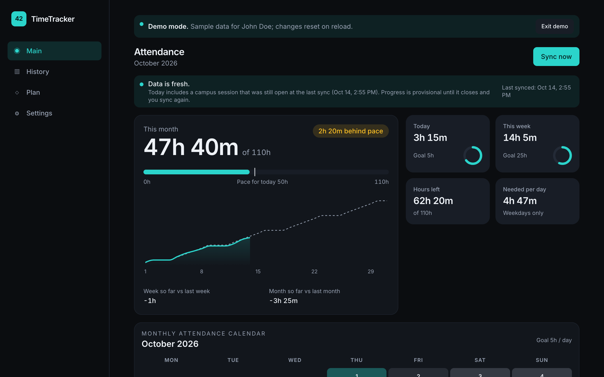
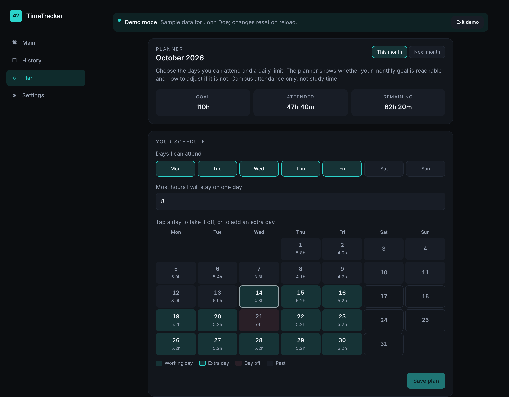
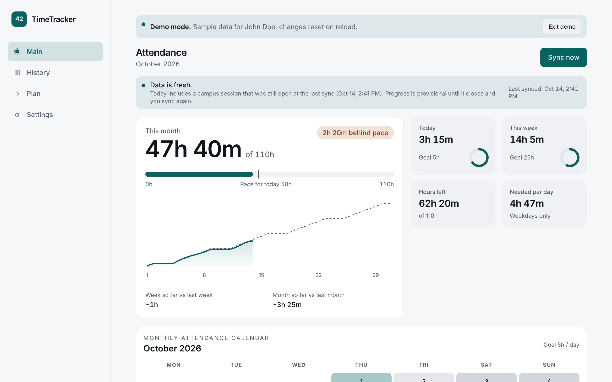
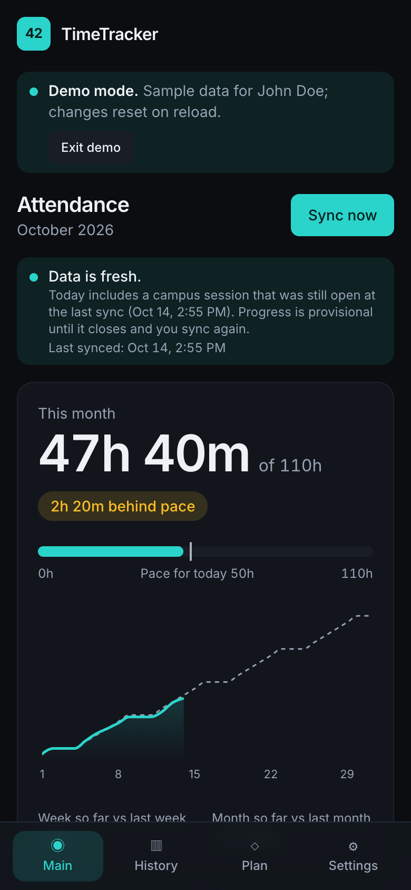
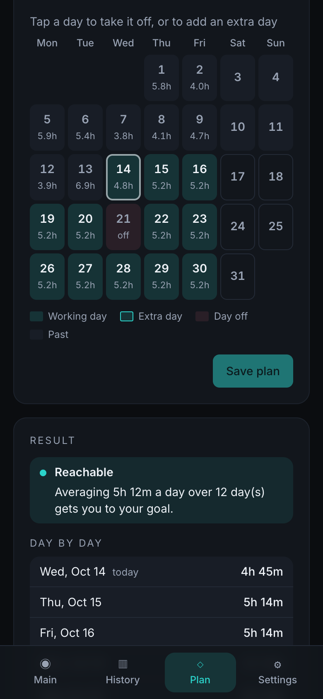

# TimeTracker42

TimeTracker42 is an attendance tracker for 42 students. It signs users in with 42 OAuth, syncs official
campus location sessions, and answers one question every day: **am I ahead or behind my monthly
attendance goal, and what does it take to get there?**

[](https://github.com/Equinox201/TimeTracker42/actions/workflows/ci.yml)

- **Live app:** https://timetracker42.pages.dev/
- **Try it without a 42 account:** https://timetracker42.pages.dev/demo (sample data for a fictional student, John Doe)
- **How it was built, and what went wrong along the way:** [docs/case-study.md](docs/case-study.md)

## Preview







| Planner | Dashboard, light theme |
|---|---|
|  |  |

| On a phone: dashboard | On a phone: planner |
|---|---|
|  |  |

All screenshots are generated from demo mode with `npm run screenshots` in `web/`.

## What It Does

- **Pace-first dashboard.** The month's hours against a straight-line pace for today, a status
  ("2h 20m behind pace"), a cumulative-vs-pace chart, and today / week / hours-left / needed-per-day.
- **Attendance planner.** Pick the weekdays you can attend and a daily limit, tap days on a month
  calendar to take them off or add extras, and see whether the monthly goal is reachable. When it is not,
  the planner shows the shortfall and concrete fixes you can apply in one click.
- **Goals and deadlines.** Daily, weekly and monthly goals; project deadlines whose progress is measured
  from their own start date.
- **History.** Six months of totals and a month calendar with attendance per day.
- **Manual sync** from the 42 API with clear freshness and failure status.
- **Demo mode** with synthetic data, and light / dark / system themes.
- **Your data, your call.** A "Delete my data" button removes the account and everything stored for it; see [docs/privacy.md](docs/privacy.md).
- **Responsive.** A bottom tab bar on phones (PWA-friendly), a side navigation and two-column
  dashboard on desktop.

### Pages

| Route | Page |
|---|---|
| `/login` | Landing page: value proposition, "Continue with 42", "Try the demo" |
| `/demo` | Enters demo mode and redirects to the dashboard |
| `/auth/callback` | Completes the 42 sign-in |
| `/app/main` | Dashboard |
| `/app/history` | Six-month history and monthly calendar |
| `/app/plan` | Attendance planner |
| `/app/settings` | Theme, account, goals, deadlines and "Delete my data" |

## Demo Mode

Anyone can explore the full app without a 42 account at `/demo`, or with the **Try the demo** button on
the landing page.

- Everything is synthetic: attendance, goals, deadlines, plans and sync history for a fictional student.
- No requests go to Supabase or 42 while demo mode is on, so it also works on deploy previews that have
  no backend configuration.
- Data is generated relative to the current Singapore date, so the dashboard always shows a current month.
- It plugs in at the data-access layer (`web/src/demo/`), so the real pace, goal and planner calculations
  run over the generated rows. Edits (goals, deadlines, plans, manual sync) live in memory and reset on reload.

## Architecture

```text
[Cloudflare Pages: React/Vite web app]
          |
          | Supabase Auth session + RLS-protected table reads/writes
          v
[Supabase Auth] ---- [Supabase Postgres + RLS]
          ^
          |
[Supabase Edge Functions]
  - forty-two-oauth-start
  - forty-two-oauth-callback
  - auth-exchange
  - forty-two-sync-manual
  - delete-account
          |
          v
       [42 API]
```

More detail, including sequence descriptions of sign-in and sync, is in
[docs/architecture.md](docs/architecture.md); request and response shapes are in
[docs/api-contract.md](docs/api-contract.md).

### Frontend

- React, TypeScript, Vite, Tailwind CSS, React Query and Recharts, hosted on Cloudflare Pages.
- Reads and writes its own data directly from Supabase under row-level security.
- Calls Edge Functions only for 42 OAuth and manual sync.
- Pure, unit-tested logic for the interesting parts: `pace`, `planner`, `deadlines`, `comparison`,
  `cumulative`, `goalMath` and the Singapore date helpers (all in `web/src/lib/`).

### Auth

- Supabase Auth owns the browser session.
- 42 OAuth is implemented with custom Edge Functions:
  - `forty-two-oauth-start` stores a hashed OAuth state (and the login binding) and redirects to 42.
  - `forty-two-oauth-callback` validates state, exchanges the 42 code server-side, stores 42 tokens,
    and issues a one-time exchange code.
  - `auth-exchange` redeems the exchange code, for the browser that holds the matching verifier, and
    returns a Supabase `token_hash` that the browser verifies with Supabase Auth.
- A development-only email OTP fallback exists and is hidden by default.

### Data

- User-facing tables (RLS, own rows only): `profiles` (read-only for users), `goals`, `deadlines`,
  `attendance_daily`, `location_sessions`, `sync_runs`, `attendance_plans`.
- Server-only tables (no API-role access at all): `forty_two_tokens`, `oauth_states`,
  `auth_exchange_codes`.
- `finalize_sync()` is a service-role-only database function that persists a sync atomically.

### Manual Sync

- `forty-two-sync-manual` requires a Supabase JWT, reads the user's stored 42 token server-side, and
  refreshes it when needed.
- It fetches location sessions from `GET https://api.intra.42.fr/v2/users/:id/locations` for a bounded
  window (from the first day of the month five months back through now, plus active sessions).
- Presence is elapsed time: overlapping or touching sessions are merged before totals are split at
  Singapore midnight, and sessions that began just before the window are included so its first day is
  accurate.
- Days stored locally that 42 no longer reports (after a complete fetch) are reconciled to zero; an
  entirely empty result never wipes history.
- One sync runs per user at a time (a unique index on running runs), with a short cooldown after a
  success; runs abandoned by a crash are recovered automatically.
- Calls to 42 have a timeout and bounded retries on 429/502/503/504, honouring `Retry-After`.
- Results are written by a single database function, so sessions, daily totals and the run status land
  in one transaction.
- Today's row is marked `locations_live` while a session is open, and the dashboard shows it as
  provisional with the time of the last sync.

## Repository Structure

```text
web/                      React + TypeScript frontend (Cloudflare Pages)
  src/lib/                Pure logic: pace, planner, deadlines, dates, formatters
  src/components/ui/      Design-system primitives (Card, Button, Banner, Stat, ...)
  src/demo/               Synthetic data and in-memory store behind demo mode
  e2e/                    Playwright: demo flow, accessibility, screenshot generator
supabase/
  migrations/             Schema, RLS policies, grants, sync lock and finalize function
  functions/              Edge Functions; _shared/ holds logging, crypto, binding,
                          attendance maths and HTTP retry (with Deno tests)
  tests/database/         pgTAP tests for grants and row-level security
docs/                     Architecture, API contract, runbook (incl. incident notes), case study
assets/screenshots/       README images, generated from demo mode
.github/workflows/        CI
```

## Configuration

### Frontend environment variables

Set these in Cloudflare Pages and in `web/.env` (copy `web/.env.example`):

```env
VITE_SUPABASE_URL=
VITE_SUPABASE_PUBLISHABLE_KEY=
VITE_SUPABASE_FUNCTIONS_URL=
VITE_ENABLE_EMAIL_OTP_FALLBACK=false
```

They are only needed for real sign-in and data. Without them the app still builds and demo mode works,
which is what deploy previews rely on. `VITE_ENABLE_EMAIL_OTP_FALLBACK` must be exactly `true` to show
the development email fallback; production leaves it `false` or unset.

### Supabase Edge Function secrets

Set these with Supabase secrets, never in frontend variables:

```text
EDGE_SUPABASE_URL
EDGE_SUPABASE_SERVICE_ROLE_KEY
FORTY_TWO_CLIENT_ID
FORTY_TWO_CLIENT_SECRET
FORTY_TWO_REDIRECT_URI
FORTY_TWO_AUTH_EMAIL_DOMAIN
APP_ORIGIN
REQUIRE_LOGIN_BINDING   # "true" rejects logins that arrive without a browser binding
```

## Local Development

```bash
cd web
cp .env.example .env     # optional: demo mode works without it
npm install
npm run dev              # http://127.0.0.1:5173
```

Open `/demo` to explore without any backend.

## Deployment

### Frontend (Cloudflare Pages)

```text
Root directory: web
Build command: npm run build
Build output directory: dist
```

Configure the frontend environment variables for the production environment (and for previews if you
want real sign-in there).

### Database and Edge Functions

In this project's setup, merging to `main` deploys the Edge Functions and applies new migrations through
the Supabase GitHub integration. They can also be deployed by hand:

```bash
npx supabase db push
npx supabase functions deploy forty-two-oauth-start
npx supabase functions deploy forty-two-oauth-callback
npx supabase functions deploy auth-exchange
npx supabase functions deploy forty-two-sync-manual
npx supabase functions deploy delete-account

npx supabase secrets set FORTY_TWO_CLIENT_ID=... FORTY_TWO_CLIENT_SECRET=...
npx supabase secrets set FORTY_TWO_REDIRECT_URI=... FORTY_TWO_AUTH_EMAIL_DOMAIN=... APP_ORIGIN=...
```

Do not commit secret values. Rolling out browser-bound login and rotating the 42 client secret are
documented step by step in [docs/runbook.md](docs/runbook.md).

## Design Decisions

- **Custom 42 OAuth on Edge Functions.** The browser never sees 42 tokens or the client secret. The
  callback exchanges the code server-side, maps the stable 42 user id to a Supabase user, and hands the
  browser a one-time exchange code instead of a session.
- **Browser-bound login.** Before leaving for 42 the browser keeps a random verifier and sends only its
  SHA-256. The binding rides with the OAuth state and the exchange code, and redeeming the code requires
  the original verifier, so a callback URL replayed in another browser cannot sign it in (login CSRF).
  Redemption is one conditional `UPDATE`, so a wrong verifier does not burn the code.
- **Least-privilege database access.** API roles can only read their own rows (and write goals,
  deadlines and plans). The 42 identity mapping, tokens, sync data and auth tables are writable only by
  Edge Functions, enforced by grants and covered by pgTAP tests.
- **Single-use, hashed secrets.** OAuth state and exchange codes are stored as SHA-256 hashes and consumed
  once. The frontend shares one in-flight sign-in per callback URL, because React effects can re-run and
  a consumed code is (correctly) rejected.
- **RLS instead of an API server.** The web app reads and writes its own rows straight from Supabase;
  Edge Functions exist only where a secret or the 42 API is involved.
- **Planning is separate from goals.** The goal is the target; the planner is the schedule used to reach
  it. A recommendation never rewrites the goal, and deadline progress is measured from each deadline's own
  start date rather than "this month so far".
- **Pace is explicit and testable.** Expected hours are linear over the days that count (weekdays or
  calendar days); "ahead / on pace / behind" has a stated tolerance, and "vs last week / month" compares
  the same stretch rather than a partial period against a full one.
- **Singapore operational days.** `attendance_daily.day` is keyed by `Asia/Singapore`, and the sync
  function and UI share that rule (`web/src/lib/singaporeDate.ts`), so day, week and month totals agree.
- **Safe failures.** Sync errors store short messages only; detailed reasons go to structured logs
  without tokens, codes or secrets.
- **Demo mode as a first-class path.** It runs the real calculations over synthetic data, which also
  makes the app reviewable on any deploy preview and testable without a backend.

## Observability

Every Edge Function logs one JSON line per event (`fn`, `event`, `request_id`). The runbook maps each
browser-visible `error=` code to the log event that explains it:
[docs/runbook.md](docs/runbook.md#diagnosing-sign-in-failures).

## Quality Gates

CI runs four jobs on every pull request and on `main`:

| Job | What it checks |
|---|---|
| Web | `npm run typecheck`, `npm test` (Vitest), `npm run build` |
| End-to-end and accessibility | Playwright on a desktop and a phone viewport against the production build with no Supabase config; axe-core (WCAG 2 A/AA) on every page in light and dark |
| Edge Functions | `deno test` for the shared modules, `deno check` for each function |
| Database | Migrations applied to a fresh local Supabase, then pgTAP tests for grants and row-level security |

Run them locally:

```bash
cd web
npm run typecheck && npm test && npm run build

npx playwright install chromium     # once
npm run e2e                         # PW_CHANNEL=chrome uses an installed Chrome instead

deno test supabase/functions/_shared/
supabase start && supabase test db  # needs Docker
```

Automated accessibility checks are a floor, not a substitute for keyboard and screen-reader testing.
The colour tokens have their own contrast test (`web/src/styles/contrast.test.ts`), including text on
tinted backgrounds.

## Security

- 42 access and refresh tokens stay server-side in Supabase and never reach the browser.
- The Supabase service role key and the 42 client secret are used only inside Edge Functions.
- Frontend clients use Supabase Auth sessions and RLS-protected access, with least-privilege grants:
  `anon` has no table access, and users cannot write `profiles` (so the 42 identity mapping cannot be
  edited) or any sync data.
- OAuth state and auth exchange codes are stored only as SHA-256 hashes and are single-use.
- Login is bound to the browser that started it (PKCE-style verifier); `REQUIRE_LOGIN_BINDING=true`
  also rejects logins that omit the binding.
- Sync errors store safe short messages only, not raw payloads, tokens or stack traces.

## Known Limitations and Roadmap

- Goal changes are not versioned, so changing today's goal reclassifies past calendar days.
- Sync is manual; scheduled, incremental sync is the natural next step.
- Planning models campus attendance only, not study time or per-project allocation.
- Offline history and CSV export are not built.
- 42 tokens could be encrypted or moved to Vault-backed storage.
- The development email OTP fallback should be removed once production 42 login has enough burn-in.
- Visual regression tests (Playwright screenshots) are not in CI; screenshots are generated on demand.

## License

MIT. See [LICENSE](LICENSE).
